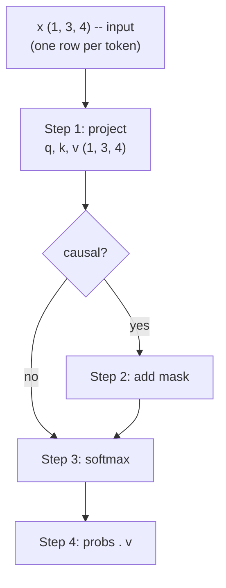

# 001 — Softmax and scaled dot-product attention, by hand

**Companion to:** [`notes/attention.md`](../notes/attention.md)
· **Code:** [`model/attention.py`](../../model/attention.py)
· **Every number here is reproduced by:** [`check_softmax.py`](check_softmax.py)
(`uv run python scripts/check_softmax.py`)

---

## How to read this

This walkthrough pushes one tiny input through every line of an attention
head (a query, a set of keys, and their values) and does the arithmetic on
paper, then checks each result against the code. You do **not** need a
linear-algebra background: every term (vector, dot product, norm, softmax,
Cauchy–Schwarz) is defined at first use.

We

1. fix one tiny input (§1),
2. walk **every operation** of `Attention.forward`
   ([`attention.py:42`](../../model/attention.py#L42)) with `causal=True` (§2),
3. then check the bound on the scores (§3).

---

## Part 0 — What are we computing?

A single attention head computes (Vaswani et al. 2017)

$$\text{Attention}(Q, K, V) = \operatorname{softmax}\!\left(\frac{QK^{\top}}{\sqrt{d_k}} + M\right) V$$

where $Q$, $K$, $V$ hold one row per token, $QK^{\top}$ is the all-pairs
similarity score, and $M$ is the causal mask. The number $q_i \cdot k_j$ is
called an **attention score**.



The final output, computed by hand in §2:

```
[[1.000000, 0.000000, 0.000000, 0.000000],
 [0.268941, 0.731059, 0.000000, 0.000000],
 [0.211942, 0.211942, 0.576117, 0.000000]]
```

---

## Part 1 — The running example

### 1.1 Terms we need

- **Vector:** an ordered list of numbers, e.g. $[3, 0, 4, 0]$. Its **length**
  is how many numbers it holds (here $4$).
- **Dot product:** multiply component by component and add.
  $[3,0,4,0]\cdot[1,1,1,1] = 3+0+4+0 = 7$.
- **Norm** (written $\lVert a\rVert$): $\sqrt{a\cdot a}$, the length of the
  arrow. $\lVert[3,0,4,0]\rVert = \sqrt{9+16} = 5$.
- **Transpose** $A^{\top}$: flip rows ↔ columns.
- **Mean** of $n$ numbers: their sum $\div n$.

### 1.2 The configuration

| Symbol | Meaning | Value |
|---|---|---|
| `seq_len`, $S$ | tokens in the sequence | $3$ |
| `head_dim`, $d_k$ | width of one head | $4$ |
| `causal` | mask future tokens | **`True`** |
| `scale` | divide scores by | $\sqrt{d_k} = 2$ |

### 1.3 The input

Each token embedding is a **one-hot** vector, so the matrix is

$$X = \begin{bmatrix} x_0 \\ x_1 \\ x_2 \end{bmatrix}
= \begin{bmatrix}
1 & 0 & 0 & 0 \\
0 & 1 & 0 & 0 \\
0 & 0 & 1 & 0
\end{bmatrix}$$

This makes each projected $q_i$ **exactly the $i$-th column of $W_Q$**, and
the output projection is the identity: $1$s on the diagonal.

---

## Part 2 — The forward pass

### Step 1 — Project

Code ([`attention.py:50-52`](../../model/attention.py#L50)):

```python
q = self.w_q(x)
k = self.w_k(x)
v = self.w_v(x)
```

Every vector here is length-$4$. We write $q^{(0)}_1$ for head $0$, token $1$.

### Step 2 — Scores and the mask

Scores are $q_i \cdot k_j / \sqrt{d_k}$, then the mask sends future tokens to
$-\infty$:

$$M = \begin{bmatrix} 0 & -\infty & -\infty \\ 0 & 0 & -\infty \\ 0 & 0 & 0 \end{bmatrix}$$

### Step 3 — Softmax

$$p_j = \operatorname{softmax}(z)_j = \frac{e^{z_j}}{\sum_{l=1}^{S} e^{z_l}}$$

**Row 1:** $[0, 1, -\infty]$ → $e^0 = 1$, $e^1 = 2.71828183$, sum
$= 3.71828183$, so $p = [0.26894142, 0.73105858, 0]$. ✓

> **Why subtract the max?** Softmax is shift-invariant, so implementations
> subtract $\max_l z_l$ first and nothing overflows. The result is the same
> to $3\times10^{-8}$.

### Step 4 — Weighted sum

$$\boxed{\ \text{output} \approx \begin{bmatrix}
1 & 0 & 0 & 0 \\
0.2689 & 0.7311 & 0 & 0
\end{bmatrix}\ }$$

---

## Part 3 — The bound

For any two vectors, $|a \cdot b| \le \lVert a\rVert \, \lVert b\rVert$, so a
score is at most $d_k$ when both norms are $\sqrt{d_k}$ — about $2.0$ after
scaling (≈ the ceiling we measured).

| step | operation | shape |
|---|---|---|
| 1 | project | `(1, 3, 4)` |
| 2 | scores + mask | `(1, 3, 3)` |
| 3 | softmax | `(1, 3, 3)` |

See §1.2 for the configuration and `H \bmod H_{kv}` style checks in
[`config.py:10-14`](../../model/config.py#L10).
