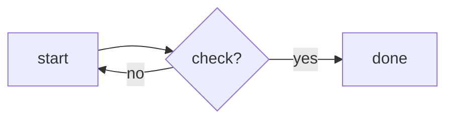

# Kitchen *sink* for the reader

A paragraph with **bold**, _emphasis_, `inline_code()`, a [link](https://example.com/docs) and a bare URL https://github.com/foo/bar. It costs ~5% more — sometimes. See §2 and CLAUDE.md for details (or not).

<!-- an html comment that must stay silent -->
<details><summary>Hidden</summary>raw html</details>

## Lists

1. First ordered item
2. Second item with $x^2$ inside
   - nested bullet one
   - nested bullet two

- [x] finished task
- [ ] open task

> [!WARNING]
> Do not run this in production.

> **Aside.** A bold-titled quote.

---

## Table

| Name | Value | Note |
|---|---:|---|
| alpha | 0.99999952 | first |
| beta |  | `beta_v2` |

## Code

```python
def f(x):
    return x ** 2
```

```
[[1.000000, 0.000000],
 [0.568624, 0.431376]]
```



$$
\frac{a}{b} = \sqrt{c}
$$


Final line with a footnote.[^1]

[^1]: The footnote text.
